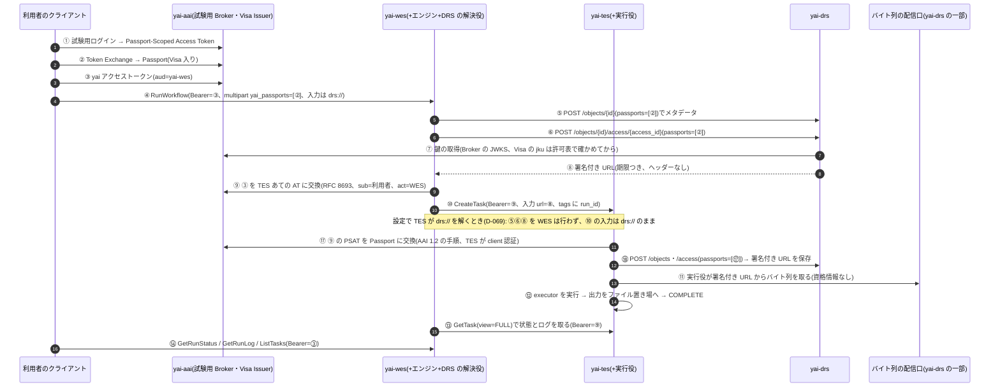

# 全体の設計(system)

- 作成: 2026-10-15。対象: yai-aai・yai-drs・yai-tes・yai-wes の 4 つを 1 つにまとめたときの呼び出し・資格情報・ID・時刻・利用者の分離
- **「仮」** と書いたものは、迷ったのでおすすめで決めたもの。`docs/decisions.md` に同じ番号(D-xxx)で理由とともにある
- 個別の設計: `aai.md`・`drs.md`・`tes.md`・`wes.md`。仕様の義務の ID(例 `DRS-ID-02`)は `docs/spec-obligations.md`、食い違いの番号(例 G-WES-01)は `docs/spec-gaps.md`

## 1. 前提(決まっていること)

| 番号 | 中身 |
| --- | --- |
| D-001 | Python・FastAPI(2026-10-15 13:38 ユーザー。22:3x の言語の比較でも Python のまま。`language.md`) |
| D-002 | 学習用(当初は自分だけが使い外に公開しない前提。D-065 で Apache-2.0 で公開に変更)。待ち受けは `127.0.0.1` か docker の内部ネットワークだけ |
| D-003 | DRS は入力だけ。TES・WES の出力は普通のファイル置き場(DRS に登録しない) |
| D-004 | AAI は受け取って確かめる側(Clearinghouse)が本命。発行する側(Broker・Passport Issuer・Visa Issuer)は試験用の最小限 |

## 2. 登場するもの

| 名前 | 役 | 既定の場所(最小版) | 試験環境(4 つまとめて、docker compose) |
| --- | --- | --- | --- |
| yai-aai | 試験用 Broker+Passport Issuer、試験用 Visa Issuer、Clearinghouse の部品(ライブラリ) | `http://127.0.0.1:8401` | `https://aai.yai.test` |
| yai-drs | DRS 1.5.0 サーバー+バイト列の配信口 | `http://127.0.0.1:8402/ga4gh/drs/v1` | `https://drs.yai.test/ga4gh/drs/v1`(443) |
| yai-tes | TES 1.1 サーバー+実行役(手元の Docker) | `http://127.0.0.1:8403/ga4gh/tes/v1` | `https://tes.yai.test/ga4gh/tes/v1` |
| yai-wes | WES 1.1.0 サーバー+エンジン(最小版は内蔵の小さなもの、D-014 決定)+DRS の解決役 | `http://127.0.0.1:8404/ga4gh/wes/v1` | `https://wes.yai.test/ga4gh/wes/v1` |
| 利用者のクライアント | 試験のコード、curl、他の実装のクライアント | — | — |

- 試験環境の `*.yai.test` は compose の内部 DNS と、手元で作った CA の TLS(Caddy など、仮 D-017)。**DRS のホスト名型 URI が https・443 固定(DRS-URI-02)なので、仕様どおりに解決できる環境を 4 つまとめた試験では用意する**
- compose 一式は `deploy/`(D-035。段階 2 から手元の rootless Docker で動かす、D-037。`tools/compose_e2e.sh`)。TLS は Caddy が網の中の 443 で受け、ホストへは `127.0.0.1:8443`(変数)だけを出す。各サービスは `SSL_CERT_FILE` で手元の CA だけを信頼する
- 単体の最小版は http とポート番号で動かし、DRS の解決役に「ホスト名 → 実際の URL」の上書き表を渡す(仕様からの逸脱。試験の設定にだけ置く、G-DRS-01)

## 3. 呼び出しの図(4 つまとめて動く流れ)

**ジョブの入出力の資格情報の運び方(WES 1.1.0 は対象外 G-WES-01、TES 1.1 にはその欄が無い G-TES-05)は、3 案から (a) を仮に選ぶ(D-007)**

| 案 | 中身 | よい点 | 悪い点 |
| --- | --- | --- | --- |
| **(a) 仮に採用** | WES の解決役が `drs://` を DRS の `/access` で**署名付き URL** に変え、TES には普通の https の `tesInput.url` として渡す(DRS の取り方の 4 番目) | TES は仕様の範囲だけで動く。他の TES(Funnel・TESK など)にもそのまま渡せる(相互運用に強い)。TES は利用者の資格情報を持たない | 署名付き URL の期限が「TES の待ち+取得」を超える必要がある。WES が TES へ出す直前まで Passport を持つ。`AccessURL.headers` を使う方式は TES に渡せない(G-X-05) |
| (b) | TES が作成時に利用者の資格情報を預かり、自分で `drs://` を解決する | DRS の URI のまま TES に渡せる | TES 1.1 に資格情報の欄が無い(独自の拡張が要る)。預かった資格情報の保管と期限切れ。他の TES と相互運用できない |
| (c) | DRS が TES のサービスの身元を信頼して、利用者に代わって出す | 実装が楽 | DRS で利用者ごとの認可ができなくなる(D-004 の Clearinghouse の意味が無くなる) |

(b) は yai-tes の拡張として実装した(D-069、設定 `drs.enabled`、既定は切)。TES は資格情報を「預かる」のではなく、呼び手の Bearer(利用者の Passport-Scoped Access Token)を AAI 1.2 の手順で Passport に替えて `drs://` を解き、署名付き URL だけを保存する(⑰⑱)。

## 4. 各呼び出しの主体・権限・資格情報・期限

トークンの種類は 5 つ。**取り違えると危ないので、受け取る側は種類ごとに検査を分ける**(`aai.md` 3 節の表)。

| 種類 | 形 | 発行 | 誰が持つ | 誰に見せる |
| --- | --- | --- | --- | --- |
| yai アクセストークン(以下 AT) | JWT `typ=at+jwt`(RFC 9068)、ES256。`aud` はサービスごと(`yai-wes`・`yai-tes`・`yai-drs`)、`scope` で操作 | yai-aai(試験用) | 利用者、各サービス(サービス用) | 各 API の `Authorization: Bearer` |
| Passport-Scoped Access Token(以下 PSAT) | JWT、`scope` に `openid ga4gh_passport_v1`、GA4GH Claim を含まない | yai-aai(試験用 Broker) | 利用者のクライアントだけ | yai-aai の Token Exchange だけ(AAI 1.2 の流れ。ほかへ出さない) |
| Passport | JWT `typ=vnd.ga4gh.passport+jwt`、`ga4gh_passport_v1` に Visa の配列 | yai-aai(試験用 Passport Issuer) | 利用者 → WES(run の間だけ) | DRS の POST 本文 `passports` |
| Visa Document Token | JWT、ヘッダーに `jku`、`ga4gh_visa_v1` | yai-aai(試験用 Visa Issuer) | Passport の中 | (Passport の中で)DRS |
| 署名付き URL | HMAC 署名と期限つきの https URL(yai 独自の形) | yai-drs | WES → TES の実行役 | バイト列の配信口 |

**Passport を API の Bearer には使わない(仮 D-008)。** AAI 1.2 が Passport の受け渡しを決めているのは DRS の POST 本文だけで、WES・TES の Bearer が何であるべきかは決めていない。Bearer は「その API を使ってよい」ことを、Passport は「そのデータを読んでよい」ことを示すものとして分ける。

| # | 呼ぶ側 → 呼ばれる側 | 主体(誰として) | 要る権限 | 資格情報 | 有効期限 | 失敗したとき |
| --- | --- | --- | --- | --- | --- | --- |
| ① | 利用者 → aai | 利用者 | — | 試験用の利用者名(最小版は固定の利用者表。OIDC の認可コードの流れは後) | — | 401 |
| ② | 利用者 → aai(Token Exchange) | 利用者 | — | PSAT | Passport の `exp` = 発行から 120 分(仮 D-019)。中の Visa の `exp` はそれぞれ | 400(RFC 8693 の形) |
| ③ | 利用者 → aai | 利用者 | — | 試験用の利用者名 | AT は 15 分(仮 D-019) | 401 |
| ④ | 利用者 → WES RunWorkflow | 利用者 | `wes.run` | AT(`aud=yai-wes`)+multipart の yai 独自の項目 `yai_passports` に Passport(仮 D-009) | AT は受付の時点で有効なら足りる。Passport は「最後の TES タスクを出す時刻」まで要る(下の 5 節) | AT 不正 401・権限なし 403・Passport の形が不正 400 |
| ⑤⑥ | WES → DRS PostObject・PostAccessURL | **利用者の代わり**(Passport の `sub`) | Passport の Visa が、オブジェクトのデータセットへの ControlledAccessGrants を持つ | 本文の `passports=[Passport]`。WES 自身の資格情報は付けない。**送ってよい先を絞る**: (0) OPTIONS(か `AccessMethod.authorizations`)が `None` なら Passport を送らずに GET で解決する(C-26)。`PassportAuth` のときだけ:(1) 設定の「Passport を送ってよい DRS のホスト」に有る(外の DRS はホストごとに明示)、(2) `passport_auth_issuers` が Passport の中の Visa の `iss` と重なる(DRS-AUTH-07)、(3) リダイレクトに従わない。どれかに外れたら送らずに `SYSTEM_ERROR` | Passport の `exp` まで | DRS が 401・403 → run は `SYSTEM_ERROR`、`system_logs` に理由 |
| ⑦ | DRS → aai(鍵) | DRS(認証なし) | — | なし(公開鍵の取得)。`jku` は Clearinghouse の許可表に有るものだけ(AAI-CH-07) | 鍵の保持は 1 時間、`kid` が無いときだけ取り直す(1 分に 1 回まで、仮) | 鍵が取れない → その Passport は拒否(401) |
| ⑧ | DRS → WES(応答) | — | — | 署名付き URL(`AccessURL.url` だけ、`headers` なし) | **既定 60 分、設定で短くできる(仮 D-019)**。Option B により必ず Visa・Passport の `exp` より前に切れる。配信口は始まった転送も URL の期限で切る(`aai.md` 4 節) | — |
| ⑨ | WES → aai(Token Exchange) | **利用者の代わり**(WES が client 認証) | — | 利用者の AT(③、`aud=yai-wes`)を subject_token に、RFC 8693 で `aud=yai-tes` の AT に交換する(D-067)。出る AT は `sub`=利用者、`act.sub`=WES、scope は WES の client に許した `tes.submit tes.read tes.cancel`。Broker は「③ がこの WES あてに出た AT であること」を確かめる(WES は自分を呼んだ利用者の代わりにしかなれない)。WES のクライアント ID と秘密は設定ファイル、git に入れない | **交換した AT は Passport と同じ 120 分(`ttl.delegated_access_token`、仮)**。メモリだけに持ち、run が終わったら消す。受付の時点で交換するので利用者の AT(15 分)の期限は効かない | 交換できない → RunWorkflow が 500(run は作らない)。途中で切れた → これから出す段は `SYSTEM_ERROR`、見張りと取り消しは自分のサービスの AT(client_credentials)で続ける |
| ⑩ | WES → TES CreateTask | **利用者**(交換した AT の `sub`)。WES は代理(`act.sub`、D-067) | `tes.submit`。tags は `yai.run_id`・`yai.submit_nonce`(誰でも付けられる札。「誰の代わりか」は tag では運ばない) | AT(⑨ で交換したもの)。WES の client の scopes に `openid ga4gh_passport_v1` が有れば、これは PSAT でもある(D-069) | ⑨ の期限 | 401・403・400 → run は `SYSTEM_ERROR` |
| ⑰ | TES → aai(Token Exchange、`drs.enabled` のときだけ) | **利用者の代わり**(TES が client 認証) | — | ⑩ の Bearer(利用者の PSAT。利用者本人のものでも ⑨ のものでも)を subject_token に、AAI 1.2 の手順で Passport を得る(D-069)。passport-scoped でない AT・サービスの AT では 403 | Passport は使ったら捨てる(保存しない) | 交換できない → CreateTask が 403(取り消し済み)か 500(Broker に届かない) |
| ⑱ | TES → DRS PostObject・PostAccessURL(`drs.enabled` のときだけ) | **利用者の代わり**(⑰ の Passport の `sub`) | ⑤⑥ と同じ | ⑤⑥ と同じ手順・同じ絞り方(共有の解決役)。署名付き URL だけを保存し、取り終えたら問い合わせ部分を消す(D-068) | ⑧ の期限 | DRS が 401・403 → CreateTask が 403(タスクは作らない) |
| ⑪ | TES 実行役 → 配信口 | なし(URL そのものが資格情報) | — | 署名付き URL | ⑧ の期限。**期限切れならタスクは `SYSTEM_ERROR`**(取得の失敗) | `SYSTEM_ERROR` |
| ⑫ | 実行役 → 出力の置き場 | TES(サービス) | — | なし(手元のファイル。`file://` の決められた根の下だけ) | — | 出力の転送の失敗 → `SYSTEM_ERROR`(TES-ST-02) |
| ⑬ | WES → TES GetTask・CancelTask | 利用者(交換した AT。見えるのは同じ(持ち主, 代理)の組のタスクだけ)。再起動で交換した AT を失った後は **WES(サービス)**: TES は代理のサービスに、その代理が出したタスクを見せる(D-067) | `tes.read`・`tes.cancel`(自分が出したもの) | AT(⑨ で交換したもの。無ければ client_credentials のサービス用の AT、15 分、期限の 1 分前に取り直す) | 同上 | 取れない間は run の状態を変えない。30 分続いたら `SYSTEM_ERROR` にし、CancelTask を出し続ける(`wes-states.yaml`) |
| ⑭ | 利用者 → WES | 利用者 | 自分の run だけ(WES-LST-03) | AT(`aud=yai-wes`) | 15 分 | 他人の run は 404(仮 D-013) |
| ⑮ | 利用者 → TES 直接 | 利用者 | 自分のタスク(直接出したものも、WES が代理で出したものも持ち主は自分)。WES が代理で出したものは**読むだけ**(取り消しは WES の CancelRun から) | AT(`aud=yai-tes`) | 15 分 | 他人のものは 404 |
| ⑯ | 利用者 → DRS 直接 | 利用者 | オブジェクトの方針(公開/Bearer/Passport) | なし・AT(`aud=yai-drs`)・本文の Passport | — | 401・403 |

## 5. 時刻と期限

- 内部の時刻はすべて UTC の秒(整数)で持ち、外へ出すときに仕様の形にする(D-015、G-X-03)
  - DRS・TES: RFC 3339(`2026-10-15T13:00:00Z`)
  - WES: `"%Y-%m-%dT%H:%M:%SZ"`(秒まで、小数なし)。TES の時刻を WES に写すときは小数を切り捨てる
  - JWT: エポック秒
- 時計のずれの許容: JWT の `exp`・`nbf`・`iat` は 60 秒(仮)
- **期限の連鎖**(4 つまとめたときに破れやすいところ)

| 期限 | 長さ(仮) | 守る条件 | 破れたとき |
| --- | --- | --- | --- |
| AT(利用者) | 15 分 | 受付の時点で有効 | 401。長く走る run には影響しない(受付後は使わない) |
| Passport | 発行から 120 分 | WES が**各 TES タスクを出す直前**に、DRS へ ⑥ を呼ぶ時点で有効 | ⑥ が 401 → その run は `SYSTEM_ERROR`(「Passport の期限切れ」と `system_logs` に)。**Option B により、URL を出せるのは「Passport・Visa の残り > 署名付き URL の期限(60 分)」の間 = 発行から 60 分まで。最小版は「Passport を取ってから 60 分以内に最後のタスクを出す」run だけを対象にする**。長い run は「あとで深める」(Passport の取り直しの口、G-WES-01) |
| Visa | Visa Issuer が決める(試験用は 120 分) | Option B: `now + 署名付き URL の期限 + 60 秒 < min(Visa.exp, Passport.exp)`(PP-EXP-01。Passport の `exp` と時計のずれを入れるのは yai の判断) | DRS が 403 |
| 署名付き URL | 60 分 | 「TES の待ち+取得の開始」より長い | TES の取得が失敗 → `SYSTEM_ERROR` |
| 鍵の保持 | 60 分 | 鍵の入れ替えのとき、古い鍵で署名されたトークンの最長の期限より長く両方の鍵を公開する | 署名の検査に失敗 → 401 |

DRS は Option B(`now + accessTokenTTL < token.exp`)を使い、`accessTokenTTL` = 署名付き URL の期限(60 分)とする。つまり **Visa・Passport の残りが 60 分を切っていたら URL を出さない**。このため Passport・試験用 Visa の期限は URL の期限より長く(120 分)する。**同じ長さにすると、発行の直後でも条件が成り立たず URL が 1 つも出ない**(自己レビュー R-01 で見つけて直した)

TES が `drs://` を解くとき(D-069、⑰)も交換なので、取り消しは同じく次の交換から効く(取り消した利用者の PSAT では CreateTask が 403)。

**取り消しが効くまでの窓**(D-070): 発行元で権限を外しても(利用者表から Visa を外す・`/test/revoke`)、効くのは**次の交換**からで、出し済みの Passport・交換した AT・署名付き URL はそれぞれの `exp` まで使える。DRS から新しい署名付き URL を出せる窓は `min(Passport.exp, Visa.exp) − 署名付き URL の期限 − 時計のずれ`(Option B)。既定(Passport・Visa 120 分、URL 60 分、ずれ 60 秒)では**最長 59 分**、Passport・Visa 5 分・URL 60 秒のデモの設定では 180 秒(2026-11-09 の実測と一致)。窓を縮めるには Passport・Visa と URL の期限を短くする(既定は変えていない)。本物の取り消し(RFC 7009)は IdP の仕事で、試験用 Broker は持たない(G-AAI-09)

## 6. ID と URI の形

| もの | 形 | 例 | 理由 |
| --- | --- | --- | --- |
| DRS オブジェクト ID | `o` + ULID(小文字 26 文字)。`[a-z0-9]` だけなので percent-encode が要らない | `o01jab3k…` | DRS-ID-01。登録ごとに新しい ID(上書きしない、DRS-ID-02) |
| DRS `access_id` | `a` + 連番(オブジェクトの中で一意) | `a1` | DRS-AM-02 |
| DRS のホスト名型 URI(`self_uri`) | `drs://<DRS のホスト名>/<ID>` | `drs://drs.yai.test/o01jab…` | DRS-OBJ-03 |
| DRS の compact identifier 型 URI | yai は**出さない**(identifiers.org に登録しないため、DRS-URI-06)。解決はできる:手元の解決表に `prefix → URL パターン` を持つ(試験用の prefix `yaitest.drs`、仮) | `drs://yaitest.drs:o01jab…` | DRS-URI-01・04。外の meta-resolver は使わない(使わない理由:学習用で外に依存しない。Compact Identifier の付録の「外のサイトに頼らない運用」に当たる) |
| TES タスク ID | `t` + ULID | `t01jab…` | |
| WES run ID | `r` + ULID | `r01jab…` | |
| WES のタスク ID(TaskLog.id) | `<run_id>.<step 番号>` | `r01jab….1` | |
| TaskLog.tes_uri | TES の GetTask の URL | `https://tes.yai.test/ga4gh/tes/v1/tasks/t01jab…` | |
| データセット(認可の単位) | URL(Visa の `value` と比べる) | `https://yai.test/datasets/ds1` | PP-VISA-04(URL Claim) |
| 利用者の身元 | `(iss, sub)` の組。`sub` だけで比べない | `(https://aai.yai.test/, alice)` | Passport の `sub` と Visa の `sub` が違いうる(G-AAI-06) |

## 7. 利用者の分離

- 資源(TES タスク・WES run・DRS オブジェクト)は作った主体 `owner=(iss, sub)` を**作成時に保存**する。一覧・取得・ログ・取り消し・出力の取得のすべてで比べる
- 他人の資源は「無い」と同じ 404(仮 D-013)。403 は「見えるが、その操作の権限が無い」とき(例:TES で、WES が代理で出したタスクを持ち主の利用者が取り消そうとした)
- WES が出した TES タスク(D-067): `owner=利用者`(交換した AT の `sub`)、`actor=<iss>|<WES の sub>`(AT の `act.sub`)、tags に `yai.run_id`。利用者本人は TES で**読むことだけ**できる(`tes_uri` を辿れるように)。取り消しは出した組(持ち主+代理)か、代理のサービス本人(自分の AT)。WES は自分の AT でも、自分が代理で出したタスクを読める(再起動の後の見張り)。**交換した AT で見えるのは同じ(持ち主, 代理)の組のタスクだけ**: 利用者が直接出したタスクは、その利用者の代理の AT を持つ WES にも見えない(404)
- `yai.` で始まる tags は `yai.run_id`・`yai.submit_nonce` だけで、**誰でも付けられる札**(D-071)。「誰の代わりか」を tag で運ばない(`yai.on_behalf_of` は 400)。知らない `yai.` の tag も 400
- DRS のオブジェクトに owner は無い(読み取り専用、DRS-RO-01)。認可はオブジェクトの方針(公開/Bearer/データセット)

## 8. 誤りの返し方

| | 形 | 状態コード |
| --- | --- | --- |
| DRS | `Error {msg, status_code}`(仕様) | 仕様の各操作の一覧のとおり |
| WES | `ErrorResponse {msg, status_code}`(仕様、DRS と同じ形) | 仕様の各操作の一覧のとおり。一覧に無いもの(例:RunWorkflow の 404)は使わない |
| TES | **仕様に無い**(G-TES-01)。DRS・WES と同じ `{msg, status_code}` にする(仮 D-011) | 400・401・403・404・500 |
| yai-aai | OAuth2 の誤り(`error`・`error_description`、RFC 6749・8693) | 400・401 |

- **秘密を出さない決まり**(層ごと。レビューで具体にした)。秘密 = AT・PSAT・Passport・Visa・署名付き URL の問い合わせ部分(`?` から後)・URL の userinfo(`user:pass@`、D-044)・client_credentials の秘密
  - HTTP のアクセスログ(uvicorn・前段の proxy): 道だけを残し、問い合わせ部分と `Authorization` を残さない(ログの形を設定で固定する)
  - アプリのログ: 書く前に共通の消し役を通す(JWT の形の文字列・`sig=` の値・`Authorization` を伏せ字にする)。トークンは `jti` か SHA-256 の先頭 8 文字だけ
  - 例外: 誤りの応答の `msg` に要求の本文・ヘッダーを入れない。スタックトレースは応答に出さない
  - TES の `tesInput.url` に入る署名付き URL: TES の DB には**入力を取り終わるまで**残る(取得に要る)。**読めるのは、持ち主の利用者と、代理で出した WES のサービスだけ**(`permissions.yaml`)。TES のログには問い合わせ部分を除いて書く。全部の入力を取り終えた書き込み(INITIALIZING → RUNNING)で URL の問い合わせ部分を DB から消す(D-068。再起動は RUNNING からは取り直さない)。タスクが終わったら同じ書き込みで `inputs[].content`(WES の添付もここで渡る)も項目ごと消す。起動のとき、前の版で終わったタスクにも掛ける(D-043)
  - WES の `request`(`workflow_url`・File の `location`)に入る署名付き URL: run が終わったら、終わりの状態と同じ書き込みで問い合わせ部分を消す。`system_logs` には問い合わせ部分を書かない(D-030 案 A)。`runs/<id>/` に保存した文書・添付は、run が終わったらディレクトリごと消す(終わりを書いた直後と、起動のとき。D-030 の拡張)
  - 試験: 区別できる「目印の秘密」(例 `CANARY-<乱数>`)を各資格情報に入れて流し、全ログと、資格情報を持たない人が見える応答に 1 つも出ないことを確かめる(NEG-SECRET-IN-LOG)

## 9. 4 つをまとめたときの矛盾の確かめ表

「呼ぶ側が前提にしていること」と「呼ばれる側の仕様」が合うかを 1 行ずつ。**合わないもの・あやしいものは、どう合わせたかと、確かめる試験を書く**。試験の ID は `docs/test-plan.md`。

<!-- C 表ここから: docs/data/c-checks.yaml から tools/gen_diagram.py で作る。表の中は手で直さない -->
| # | 呼び出し | 呼ぶ側の前提 | 呼ばれる側の仕様 | 判定 | 合わせ方 | 段階 | 試験 | 期待する結果 |
| --- | --- | --- | --- | --- | --- | --- | --- | --- |
| C-01 | WES → DRS(⑤⑥) | Passport を Bearer で送れば通る | DRS は Passport を POST 本文 `passports` でだけ受ける(GET では渡せない)。Auth 節の `tokens[]` は本文と食い違う | 注意 | WES の解決役は POST だけを使い、本文は `passports`(G-DRS-03) | 2 | INT-DRS-POST | ⑥ が POST で本文に `passports` を持つ。`tokens` で送ると 400 |
| C-02 | WES → DRS | `access_url` か `access_id` のどちらかで取れる | 両方とも任意で「少なくとも一方」(DRS-AM-01) | 合う | 解決役は `access_id` があれば `/access`、無ければ `access_url` を使う | 2 | INT-AM-BOTH | `access_id` のある方法は `/access` を通り、無い方法は `access_url` をそのまま使う |
| C-03 | DRS → WES → TES | DRS が返す URL を TES にそのまま渡せる | DRS の `AccessURL.headers` は任意で、使うと「ヘッダーを付けて取る」。**TES の `tesInput` にはヘッダーの欄が無い** | 合わない | yai-drs は TES に渡す用途の URL を**ヘッダーなしの署名付き URL** にする。解決役は `headers` が付いて返ってきたら、その入力を受け付けない(run は `SYSTEM_ERROR`、理由を書く)(G-X-05) | 2 | INT-HEADERS-REJECT | `headers` 付きで返る偽の DRS の入力 → run が SYSTEM_ERROR、TES にタスクが出ない |
| C-04 | WES → TES | 入力の URL に https を使える | TES は `url` の形を例示するだけ(`s3://`・`gs://`・`file://`)。対応するものは service-info の `storage` で示す | 注意 | yai-tes は `https`(と `file` の決められた根)を受ける。**`storage` は「一部であり全部とは限らない」(TES 原文)ので、https が載っていなくても拒否しない**。取れるかは設定と実際の取得で確かめる | 2 | INT-TES-STORAGE | TES の `storage` に https が無くても取れる相手で E2E-01 が通る |
| C-05 | WES → TES | 入力を取ったあとチェックサムで確かめられる | TES の `tesInput` にチェックサムの欄が無い | 合わない | 最小版は確かめない(大きさだけ WES が記録)。深める段階で yai-tes の独自の拡張か、executor の前段で確かめる(G-TES-06) | 4 | 後 | 段階 2 では TES の出力の大きさが DRS の `size` と一致することだけを確かめる。チェックサムは段階 4 |
| C-06 | WES → TES | タスクの状態を WES の状態に写せる | 両方 11 個の同じ集合。ただし WES の `CANCELING` は「止める途中」、TES は「片付け待ち」と説明が違う | 注意 | 写し方は `docs/data/state-map-tes-to-wes.yaml`。run の状態は全タスクから決める(`wes.md` 4 節) | 2 | INT-STATE-MAP | TES の各状態に対して run の状態が `state-map-tes-to-wes.yaml` どおり |
| C-07 | WES → TES GetTask | ログが返ってくる | TES の既定の `view` は `MINIMAL`(id と state だけ) | 注意 | WES は必ず `view=FULL` を付ける | 2 | INT-VIEW-FULL | WES の GetTask 要求に `view=FULL` が付く(試験用の TES で要求を記録) |
| C-08 | TES → WES の TaskLog | `stdout`・`stderr` を写せる | TES の `ExecutorLog.stdout` は**中身の文字列**、WES の `Log.stdout` は**取りに行く URL** | 合わない | WES が自分の URL(`/ga4gh/wes/v1/runs/{run_id}/tasks/{task_id}/stdout`、yai 独自、WES と同じ AT で取れる、WES-LOG-01)で返す。**TES の stdout は中身・先頭か末尾だけ・URL だけのどれもありうる**(TES 原文)ので、完全さは約束しない。URL だったら中身として配らず、その旨を返す。完全なログが要るなら executor の `stdout` をファイルにして TES の出力として保存させる(G-WES-03) | 2 | INT-LOG-URL | TES が中身・切り詰め・URL のどれを返しても、WES の stdout の口が 200 で何かを返し、URL の場合は中身として配らない |
| C-09 | TES → WES の TaskLog | `exit_code` は 1 つ | TES は executor ごとに `exit_code`(複数ありうる) | 注意 | 最小版は 1 タスク 1 executor に限る。深める段階では「最後に動いた executor」を写す | 2 | INT-EXIT-CODE | 1 タスク 1 executor の `exit_code` が写る |
| C-10 | TES → WES | 時刻をそのまま写せる | TES は RFC 3339(小数・時差つきもありうる)、WES は `%Y-%m-%dT%H:%M:%SZ` | 合わない | UTC に直して小数を切り捨てる(D-015) | 2 | INT-TIME-FORMAT | 小数・時差つきの TES の時刻が `%Y-%m-%dT%H:%M:%SZ` の UTC になる |
| C-11 | WES → TES(⑩) | 利用者の代わりにタスクを出す | TES は「利用者が出してよいか」を実装が決める(TES-AUTH-02)。代理の決まりは無い | 注意 | 利用者の AT を RFC 8693 で TES あてに交換した AT(`sub`=利用者、`act.sub`=WES、D-067)。持ち主は利用者、代理は WES。利用者は読むだけ(7 節) | 2 | INT-TES-DELEGATE, NEG-TAG-SPOOF | WES が出したタスクの持ち主は利用者(`sub`)、代理は WES(`act.sub`)、tags に `yai.on_behalf_of` は無い。`yai.on_behalf_of` は誰が付けても 400、`yai.run_id`・`yai.submit_nonce` は誰でも付けられる。利用者は自分の AT で読めるが取り消せない(403)、bob には 404 |
| C-12 | 利用者 → TES(`tes_uri`) | WES の `tes_uri` を辿ればタスクが見える | `tes_uri` は任意で、見るための資格情報は決まっていない | 注意 | 持ち主(交換した AT の `sub`)本人は自分の AT(`aud=yai-tes`)で読める(D-067) | 2 | INT-TES-URI-READ | 本人の AT で `tes_uri` が 200、別人は 404 |
| C-13 | WES ↔ TES のページング | 次のページの合図が同じ | WES は「空文字で終わり」、TES は書いていない(無いか空か) | 注意 | yai-tes は終わりで `next_page_token` を**出さない**。yai-wes は TES からの「無い」と「空文字」の両方を終わりと読む(G-X-04) | 2 | INT-PAGING-END | TES が token を出さない・空文字・null のどれでも WES の一覧が終わる |
| C-14 | 利用者 → WES の入力 | `drs://` を入力に書ける | WES は「入力の URL を理解して取りに行けること」を求める(WES-RUN-04)。`supported_filesystem_protocols` の語は決まっていない | 注意 | yai-wes の service-info に `drs`・`https` を載せる | 2 | WES-SI-PROTO | WES の service-info に `drs`・`https` |
| C-15 | WES の解決役 → DRS | ホスト名型 URI から URL が作れる | 仕様は https・443 固定 | 合わない | 4 つまとめた試験は TLS の 443。単体は上書き表(G-DRS-01) | 2 | INT-DRS-HOSTNAME | TLS の 443 で `drs://drs.yai.test/<id>` が解決できる |
| C-16 | WES の解決役 → DRS | compact identifier 型も解決できる | 解決には identifiers.org・n2t.net を使う前提 | 注意 | 手元の解決表(G-DRS-02) | 2 | INT-DRS-COMPACT | `drs://yaitest.drs:<id>` が手元の解決表で解決できる |
| C-17 | DRS(Clearinghouse) ← Passport | Passport の `aud` で、自分あての Passport か分かる | Passport の `aud` は任意 | 注意 | 試験用 Broker は `aud=["yai-drs"]` を付ける。yai-drs は `aud` が有れば自分を含むことを要求、無ければ受ける(設定で「必須」にできる)(G-AAI-03) | 2 | AAI-AUD | `aud` が別のサービスの Passport は 401、`aud` 無しは設定どおり |
| C-18 | 利用者 → WES(Passport を預ける) | WES に Passport を渡す欄がある | **WES 1.1.0 に無い**(資格情報の受け渡しは対象外) | 合わない | multipart の `yai_passports`(仮 D-009)。`RunRequest` に入れないので `RunLog.request` に出ない。`RunLog.request` には残さない。run が終わったら消す | 2 | NEG-PASSPORT-NOT-LOGGED | Passport が `RunLog.request`・DB・ログに無い |
| C-19 | WES がPassport を DRS に渡す | 渡してよい | AAI は「トークンを第三者に広げない」(RFC 6819 5.1.6)を求める | 注意 | yai-wes と yai-drs を**同じ運用者の 1 つの信頼の範囲**とみなす(D-002)。Passport を TES・エンジン・ログには渡さない | 2 | NEG-PASSPORT-NOT-IN-TES | Passport が TES のタスク・ログに無い。許していない DRS に届かない |
| C-20 | WES → TES の取り消し | CancelRun で TES のタスクも止まる | TES の CancelTask は空の応答。終わったタスクへの取り消しは未定義 | 注意 | 終わったものへの取り消しは 200 で何もしない(D-020)。WES は `CANCELING` にしてから全タスクに CancelTask、全部が終わったら `CANCELED` | 2 | INT-CANCEL-RACE | 終わった run・タスクへの取り消しが 200 で状態が変わらない。取り消し中に新しいタスクが出ない |
| C-21 | DRS の時刻 → 期限の判断 | Visa の `exp` で判断できる | Passport は Option A・B のどちらかを求める | 注意 | Option B、`accessTokenTTL` = 署名付き URL の期限(5 節) | 2 | AAI-EXP-OPTB | Visa の残りが URL の期限+時計のずれ以下のとき URL が出ない(境目の前後 1 秒) |
| C-22 | service-info 3 つ | 同じ service-info 1.0.0 の `Service` | 3 つとも v1.0.0 を外部 `$ref` | 合う | 共通の部品で作る。`type.version` は各仕様の版(`1.5.0`・`1.1.0`・`1.1.0`) | 2 | SI-ALL | 3 つの service-info が service-info 1.0.0 の形に合う |
| C-23 | 誤りの形 | 3 つで同じ形 | DRS・WES は `{msg, status_code}`、TES は無し | 注意 | TES も同じ形(D-011) | 2 | ERR-SHAPE | TES の 4xx が `{msg, status_code}` |
| C-24 | 一括取得(WES → DRS) | 複数の入力を 1 回で解決できる | 一括は Passport か「1 つの Bearer」だけ、`maxBulkRequestLength` を超えると 413 | 注意 | 最小版の解決役は 1 件ずつ呼ぶ。一括は DRS 単体の試験で確かめる | 1(単体) | DRS-BULK-* | 一括を使わずに E2E-01 が通る(一括は DRS の単体の試験) |
| C-25 | WES のステップの間(TES の `file://`) | 前のステップの出力を次のステップの入力にできる | TES はタスクごとの所属を知らない。WES が出したタスクの持ち主はすべて WES のサービス | 合わない | TES の出力の記録に「持ち主・代理(`act.sub`)・`yai.run_id`・作ったタスク」を残す。代理で出すタスクの `file://` の入力は、**同じ持ち主・同じ代理・同じ `yai.run_id`** の出力だけ。利用者が直接出すタスクは、自分が直接出したタスクの出力だけ(D-067) | 2 | INT-FILE-SAME-RUN | 同じ run のステップの間は通る。別の利用者・別の run の出力を指すと 400 |
| C-26 | WES の解決役 → 公開の DRS | DRS の解決にはいつも Passport が要る | DRS の取り方は公開(認証なし)もある。相互運用の最初の相手(passport-playground-drs)は Passport の POST を持たない | 注意 | 先に OPTIONS(か `AccessMethod.authorizations`)を見て、`None` なら **Passport を送らずに** GET で解決する。Passport を送るのは `PassportAuth` のときだけ、かつ「Passport を送ってよい DRS のホスト」の設定に有るとき。外の DRS はホストごとに明示して足す(同じ運用者の範囲という C-19 の理由は外の DRS には使えない) | 2 | INT-DRS-PUBLIC | 公開の DRS には Passport が 1 度も届かず、解決できる |
| C-27 | WES → TES(署名付き URL の期限) | URL は TES が取るまで有効 | DRS の `AccessURL` に期限の欄が無い(G-DRS-10)。外の DRS の URL の期限は分からない | 注意 | yai-drs の URL は 60 分。外の DRS の URL は期限を仮定しない。TES の取得は、401・403 なら再試行せず SYSTEM_ERROR、通信の失敗は 3 回まで(間をあけて)再試行。`Range` での続きの取得も、期限の後は 403 で SYSTEM_ERROR | 2 | E2E-07 | 期限の後に待ちを解いたタスクは SYSTEM_ERROR、期限の直前に取り始めたものは期限までに終われば COMPLETE |
<!-- C 表ここまで -->

### 9.1 数(この版、道具で数えた)

27 行。判定は 合う 2・注意 18・合わない 7。段階は 2 が 25、4 が 1(C-05 のチェックサム)、1 の単体の試験が 1(C-24 の一括)。判定の語は「合う・注意・合わない」の 3 つだけにし、どう合わせたかは「合わせ方」の列に書く(レビューで直した。前の版は「決めた」「試験環境で合わせる」も判定に使っていた)。

## 10. 試験との対応

- この表の各行は、`docs/test-plan.md` 5 節「4 つまとめて動くことの試験」の **E2E-10 の 1 項目**になる。行ごとの試験 ID と期待する結果は表の右の 2 列。試験のデータは `tests/cases/<試験 ID>.yaml`
- **段階 2 の終わりの条件**: 段階が 2 の 25 行の試験がすべて期待どおり。段階 4 の行(C-05)と単体の行(C-24)は段階 2 の条件に入れない(表に段階を書いた)
- 最初に通す流れ(E2E-01): 公開でない DRS オブジェクト 1 つを入力にした 1 ステップの run が、WES → TES → DRS と流れて `COMPLETE` になり、出力の中身が期待どおり
